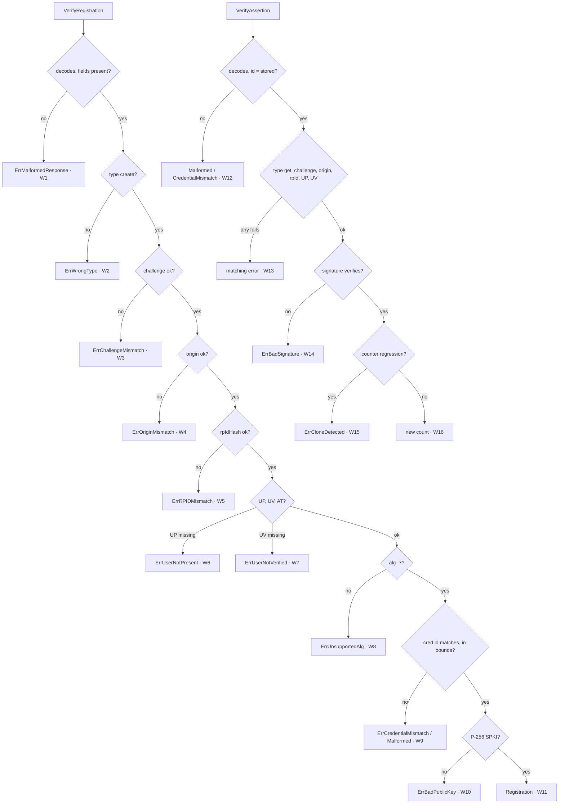

> This plan is dispatched via the CodeJob workflow. See skill: agents-workflow.

# Plan — webauthn: verify passkeys on the server

Read `AGENTS.md` first.

## Why

The iam admin panel must require a passkey (phishing-resistant MFA, NIST
SP 800-63B AAL3, PCI DSS 4.0 req. 8.4.2). This library only runs the
**browser** ceremonies today. Nothing verifies their result on the server.
This plan adds the relying-party half, `webauthn/server`, that both the native
server and a Cloudflare Worker can run.

The browser half today offers ES256 and RS256 and does not send the
credential's public key in a parseable form. Its `attestationObject` is CBOR.
WebAuthn Level 2 added `AuthenticatorAttestationResponse.getPublicKey()`
(SPKI DER), `getPublicKeyAlgorithm()` and `getAuthenticatorData()` precisely so
that relying parties need not parse CBOR. This plan sends those values and
restricts registration to ES256.

## Dependency

`webtyp.com/crypto/asym.Verify(message, signature, publicKey []byte) (bool, error)`
already exists: ASN.1 DER signature, SPKI DER public key, SHA-256 of `message`
inside. That is exactly the WebAuthn ES256 format. Add
`webtyp.com/crypto`, `webtyp.com/json`, `webtyp.com/fmt` to `go.mod` with
`go get ...@latest`.

## Design gate

1. **Prior art.**
   - go-webauthn (`webauthn.FinishRegistration` / `FinishLogin`),
     SimpleWebAuthn (`verifyRegistrationResponse` /
     `verifyAuthenticationResponse`) and py_webauthn (`verify_registration_response`
     / `verify_authentication_response`) all expose two pure verification
     functions that take the browser response plus the expected challenge,
     origin and RP id, and return the credential or the new sign count.
   - This plan keeps that two-function shape. It differs in reading SPKI from
     `getPublicKey()` instead of parsing CBOR, which is why it supports ES256
     only. All three libraries above parse CBOR to support every algorithm.
2. **Novice names.**
   - `server.RelyingParty{ID, Origin}`. "Relying party" is the WebAuthn term
     every passkey guide uses.
   - `rp.VerifyRegistration(rawResponse, challenge)`.
   - `rp.VerifyAssertion(rawResponse, challenge, stored)`.
   - `server.UnverifiedCredentialID(rawResponse)`. "Unverified" in the name
     warns the reader, as `jwt.DecodeUnverified` does.
   - Types `server.Registration` and `server.StoredCredential`.
3. **Complexity ledger.** Concepts: +1 (relying party). Ways to verify a
   passkey in the ecosystem: 0 → 1.
4. **Where it belongs.** WebAuthn protocol verification is this library's
   concern. Storing credentials and issuing sessions is `webtyp/auth`'s
   (`auth/passkey`, a separate plan).
5. **What it deletes.** RS256 (-257) from the browser's `pubKeyCredParams`:
   nothing in the ecosystem can verify it.

## Stage 1 — browser half (`create.go`)

1. `pubKeyCredParams`: keep only `{type: "public-key", alg: -7}`. Delete the
   RS256 (-257) entry.
2. Set `attestation: "none"` explicitly on the creation options.
3. `serializeCredentialCreationResponse`: inside `response`, also set, when
   the browser provides the method (check `IsUndefined()` like the existing
   `getTransports` code):
   - `publicKey`: `base64.URLEncode(arrayBufferToBytes(resp.Call("getPublicKey")))`
   - `publicKeyAlgorithm`: `resp.Call("getPublicKeyAlgorithm").Int()`
   - `authenticatorData`: `base64.URLEncode(arrayBufferToBytes(resp.Call("getAuthenticatorData")))`
4. `tests/create_test.go`: the mock browser returns these three methods. Assert
   they appear in the decoded `RawResponse` JSON, and that `pubKeyCredParams`
   passed to the mock contains exactly one entry with `alg == -7`.

## Stage 2 — `webauthn/server` (new package, no build tag)

File `server/server.go`:

```go
// Package server verifies WebAuthn responses on the relying party (ES256 only).
package server

// RelyingParty is who the passkeys are for.
type RelyingParty struct {
	ID     string // RP id: a registrable domain, e.g. "iam.velty.cl"
	Origin string // exact expected origin, e.g. "https://iam.velty.cl"
}

// Registration is what to store after a successful registration.
type Registration struct {
	CredentialID []byte
	PublicKey    []byte // SPKI DER, P-256
	SignCount    uint32
}

// StoredCredential is what the caller loaded for the credential being asserted.
type StoredCredential struct {
	ID        []byte
	PublicKey []byte // SPKI DER
	SignCount uint32
}

// VerifyRegistration checks a Credential.RawResponse against the challenge the
// server issued. It requires user presence AND user verification.
func (rp RelyingParty) VerifyRegistration(rawResponse string, challenge []byte) (Registration, error)

// VerifyAssertion checks an Assertion.RawResponse against the issued challenge
// and the stored credential, and returns the new sign count to store.
func (rp RelyingParty) VerifyAssertion(rawResponse string, challenge []byte, stored StoredCredential) (uint32, error)

// UnverifiedCredentialID returns the rawId of an Assertion.RawResponse WITHOUT
// verifying anything. Its only legitimate use is loading the StoredCredential
// to pass to VerifyAssertion; never trust it for anything else.
func UnverifiedCredentialID(rawResponse string) ([]byte, error) // ErrMalformedResponse on failure
```

Errors: a typed `type Error string` with `Error()`, and constants, verbatim:

```go
const (
	ErrMalformedResponse  Error = "webauthn: malformed response"
	ErrWrongType          Error = "webauthn: clientData.type mismatch"
	ErrChallengeMismatch  Error = "webauthn: challenge mismatch"
	ErrOriginMismatch     Error = "webauthn: origin mismatch"
	ErrRPIDMismatch       Error = "webauthn: rpIdHash mismatch"
	ErrUserNotPresent     Error = "webauthn: user presence flag not set"
	ErrUserNotVerified    Error = "webauthn: user verification flag not set"
	ErrUnsupportedAlg     Error = "webauthn: only ES256 (-7) is supported"
	ErrBadPublicKey       Error = "webauthn: public key is not a P-256 SPKI key"
	ErrCredentialMismatch Error = "webauthn: credential id mismatch"
	ErrBadSignature       Error = "webauthn: signature does not verify"
	ErrCloneDetected      Error = "webauthn: sign count did not increase (possible cloned authenticator)"
)
```

Wire types (file `server/wire.go`, unexported, decoded with `webtyp.com/json`
through `DecodeFields`, no reflection):
- `credentialJSON{ID, RawID, Type string; Response responseJSON}`;
- `responseJSON{ClientDataJSON, AttestationObject, AuthenticatorData, PublicKey, Signature, UserHandle string; PublicKeyAlgorithm int64}`;
- `clientData{Type, Challenge, Origin string}` (the challenge in clientData
  is base64url without padding).

Constants: `typeCreate = "webauthn.create"`, `typeGet = "webauthn.get"`,
`algES256 = -7`, `flagUP = 0x01`, `flagUV = 0x04`, `flagAT = 0x40`,
`rpIDHashLen = 32`, `authDataMinLen = 37`.

Registration steps (W3C WebAuthn Level 2 §7.1, reduced to ES256 + `none`):
1. base64url-decode `rawResponse` → JSON → `credentialJSON`. Any failure, or an
   empty `RawID`/`ClientDataJSON`/`AuthenticatorData`/`PublicKey` →
   `ErrMalformedResponse`.
2. Decode `clientDataJSON` → `clientData`. `Type != typeCreate` → `ErrWrongType`.
3. `subtle.ConstantTimeCompare(base64url-decode(clientData.Challenge), challenge) != 1` → `ErrChallengeMismatch`.
4. `clientData.Origin != rp.Origin` → `ErrOriginMismatch`.
5. `authData`: length ≥ `authDataMinLen`. `authData[0:32] != sha256(rp.ID)` (constant-time) → `ErrRPIDMismatch`.
6. Flags `authData[32]`: missing UP → `ErrUserNotPresent`; missing UV → `ErrUserNotVerified`; missing AT → `ErrMalformedResponse`.
7. `PublicKeyAlgorithm != algES256` → `ErrUnsupportedAlg`.
8. The attested credential data starts at byte 37: AAGUID (16 bytes), then the
   credential id length (2 bytes, big-endian), then the credential id. It must
   equal the decoded `RawID` → otherwise `ErrCredentialMismatch`. Bounds-check
   every slice: out of range → `ErrMalformedResponse`.
9. Public key: SPKI DER must be a P-256 ECDSA key → otherwise `ErrBadPublicKey`.
   Use a small unexported `isP256SPKI(der []byte) bool`: total length 91, the
   first 26 bytes equal the fixed SPKI prefix of an uncompressed P-256 key
   (hex `3059301306072a8648ce3d020106082a8648ce3d030107034200`), and byte 26 is
   `0x04`. Browsers always emit exactly this shape for ES256. Document that in
   the function comment.
10. Sign count: `authData[33:37]` big-endian. Return
    `Registration{CredentialID: rawID, PublicKey: spki, SignCount: count}`.

Assertion steps (§7.2):
1. Decode as above. Empty `ClientDataJSON`/`AuthenticatorData`/`Signature` → `ErrMalformedResponse`.
2. `RawID != stored.ID` → `ErrCredentialMismatch`.
3. clientData `Type != typeGet` → `ErrWrongType`; challenge (constant-time) → `ErrChallengeMismatch`; origin → `ErrOriginMismatch`.
4. rpIdHash → `ErrRPIDMismatch`; UP → `ErrUserNotPresent`; UV → `ErrUserNotVerified`.
5. `ok, err := asym.Verify(append(authData, sha256(clientDataJSON)...), signature, stored.PublicKey)`; `!ok || err != nil` → `ErrBadSignature`. (Build the message in a new slice; never append into `authData`'s backing array.)
6. `newCount := authData[33:37]`. If `stored.SignCount != 0 || newCount != 0` and `newCount <= stored.SignCount` → `ErrCloneDetected`. Synced passkeys report 0 forever: both zero is allowed.
7. Return `newCount`.

## Stage 3 — tests (`tests/server_test.go`, no build tag)

The test builds responses **itself**, exactly like a browser would, with a
key from `asym.GenerateKeyPair()`:
- `authData = sha256(rpID) || flags || counter(4) [|| aaguid(16) || len(2) || credID]`;
- `clientDataJSON = {"type":..,"challenge":base64url(ch),"origin":..}`;
- for assertions, `signature = asym.Sign(authData || sha256(clientDataJSON), priv)`;
- then wrap everything in the same base64url(JSON) envelope the browser half
  produces. Write one helper per envelope in the test file.

`asym.GenerateKeyPair` returns the public key as SPKI DER, so it can be used
directly as `publicKey`.

## Branch diagram



| Branch | Test |
|---|---|
| W1 | garbage base64; valid base64 of `{}` |
| W2 | `type: webauthn.get` passed to `VerifyRegistration` |
| W3 | challenge differs by one byte |
| W4 | origin `https://evil.velty.cl` |
| W5 | authData built for another RP id |
| W6, W7 | flags `0x44` (no UP); flags `0x41` (no UV) |
| W8 | `publicKeyAlgorithm: -257` |
| W9 | credential id in authData ≠ rawId; credential id length pointing past the end |
| W10 | `publicKey` = 91 random bytes |
| W11 | happy path returns id, key, count |
| W12 | assertion with a different rawId than `stored.ID` |
| W13 | one sub-test per check: type, challenge, origin, rpId, UP, UV |
| W14 | signed by another key; authData tampered after signing |
| W15 | stored 5, new 5; stored 5, new 3 |
| W16 | stored 0/new 0 → 0; stored 5/new 6 → 6 |
| `UnverifiedCredentialID` | returns the rawId of a built assertion; garbage → `ErrMalformedResponse` |

## Stages

| # | Files | Done when |
|---|---|---|
| 1 | `create.go`, `tests/create_test.go` | browser half sends SPKI, ES256 only |
| 2 | `go.mod`, `go.sum`, `server/server.go`, `server/wire.go` | compiles natively and with `GOOS=js GOARCH=wasm` |
| 3 | `tests/server_test.go` | W1–W16 green, 100% branch coverage of `server/` |
| 4 | `README.md` (section "Verifying on the server" with a 10-line example of both calls), `docs/ARCHITECTURE.md` (the two halves, why no CBOR) | docs match |

## Acceptance criteria

- `gotest` green: browser tests in the WASM suite, server tests in **both**.
- `grep -rn "cbor\|map\[" server/` → empty.
- `grep -n "257" create.go` → empty.
- Before opening the PR: `git diff --stat main` lists every file of the
  stages table, and no file is deleted that this plan does not order deleted.
